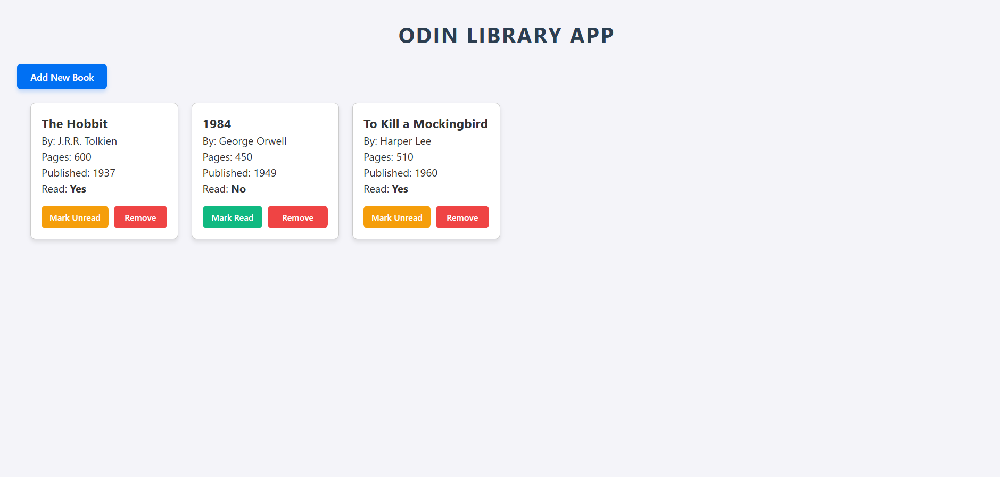

# 📚 Odin Library Application

A lightweight, interactive, and responsive web application built as part of The Odin Project curriculum to manage a personal book collection using object-oriented JavaScript patterns and dynamic DOM manipulation.

<p align="center">
  
</p>

---

## ✨ Features

- **Object-Oriented Data Management:** Utilizes a `Book` constructor pattern to instantiate structured book entities with unique cryptographic identifiers (`crypto.randomUUID()`).
- **Interactive Book Creation Modal:** Seamless pop-up form interface to add new books without reloading the page.
- **Dynamic DOM Rendering:** Automatically renders library items into responsive grid cards with conditional styling and interactive action controls.
- **Toggleable Read Status:** Real-time state management allowing users to dynamically switch a book's status between "Yes" and "No".
- **Safe Item Deletion:** Protected removal workflow featuring explicit user confirmation dialogs before removing entries from the library.

---

## 🎨 UI Architecture & Blueprint

The application employs a modal-overlay architecture coupled with a auto-filling card grid system:

- **Modal Overlay System:** Uses absolute backdrop layering and conditional CSS state classes (`.hidden`) to handle modal visibility toggles smoothly.
- **Auto-Responsive CSS Grid:** Layout automatically reorganizes cards across various screen widths without requiring complex media queries.

```text
+-----------------------------------------------------------------------+
| ODIN LIBRARY APP |
| [ Add New Book ] |
|-----------------------------------------------------------------------|
| +------------------+ +------------------+ +------------------+ |
| | The Hobbit | | 1984 | | To Kill a... | |
| | By: J.R.R. Tolkien| | By: George Orwell| | By: Harper Lee | |
| | Pages: 600 | | Pages: 450 | | Pages: 510 | |
| | Published: 1937 | | Published: 1949 | | Published: 1960 | |
| | Read: Yes | | Read: No | | Read: Yes | |
| | [Unread] [Delete]| | [Mark Read][Del] | | [Unread] [Delete]| |
| +------------------+ +------------------+ +------------------+ |
+-----------------------------------------------------------------------+
```

---

## 🚀 Live Demo

[👉 Click here to view the live deployment of the Odin Library App!](https://villa116.github.io/odin-library-app/)

---

## 🛠️ Technical Deep Dive

### Constructor Function & Object Creation

The core data structures are created using a standard JavaScript constructor function that accepts individual metadata attributes and attaches a unique identifier for array indexing.

```javascript
function Book(author, title, pages, year, read, id) {
  this.author = author;
  this.title = title;
  this.pages = pages;
  this.read = read;
  this.year = year;
  this.id = id;
}

function addBookToLibrary(author, title, pages, year, read) {
  const id = crypto.randomUUID();
  const newBook = new Book(author, title, pages, year, read, id);
  myLibrary.push(newBook);
}
```

---

## 🧱 Typographic & Card Grid Layout

The card layout uses modern CSS Grid with `auto-fill` and `minmax()` boundaries to adapt fluidly across devices without cluttering styles with hardcoded breakpoints.

```css
.card-grid {
  display: grid;
  grid-template-columns: repeat(auto-fill, minmax(200px, 1fr));
  gap: 20px;
  padding: 20px;
}
```

---

## 📁 File Structure

```text
├── index.html # Semantic structural markup and modal form container
├── style.css # Responsive layout grid, modal styling, and button themes
├── script.js # Application state, event listeners, and DOM injection logic
└── Odin Library Preview.jpg # Project workspace preview capture resource
```

---

## 💻 Installation & Usage

1. Clone the repo

   ```bash
   git clone https://github.com/Villa116/odin-library-app.git
   ```

2. Enter the folder

   ````bash
   cd odin-library-app
   ```bash

   ````

3. Open index.html in your browser
   ````bash
   open index.html
   ```bash
   ````

---

## 🧪 Technologies Used

- **HTML5:** Form handling controls, input validation attributes, and semantic structuring.
- **CSS3:** Native CSS Grid layout, flexbox alignments, modal overlay positioning, and smooth transitions.
- **JavaScript (ES6+):** Object constructors, array manipulation (`filter`, `find`, `forEach`), Web API calls (`crypto.randomUUID()`), and dynamic DOM manipulation.

---

## 🌟 Future Enhancements

- **LocalStorage Integration:** Persist book collections in browser storage so data remains across page refreshes.
- **Form Validation UI:** Add custom inline error messages for blank fields before submit triggers.
- **Search & Filter Controls:** Allow users to filter books by read status or search by title/author directly.

Developed with ❤️ by Villa Bukasa
